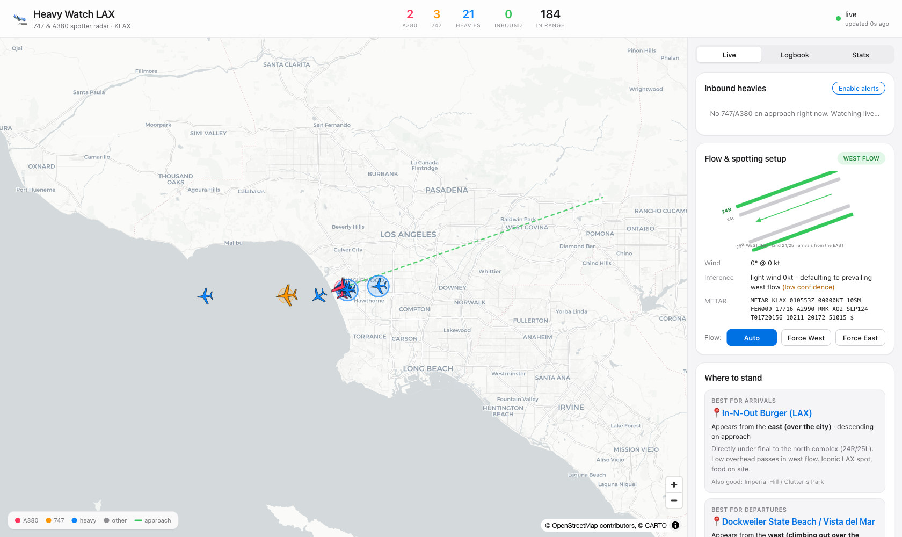
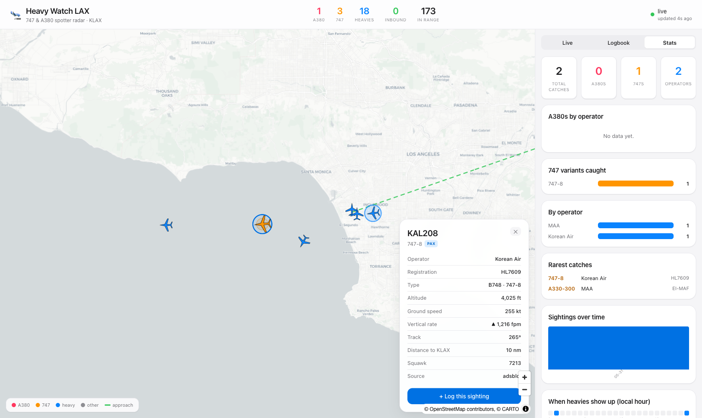

# 🛬 Heavy Watch LAX

A real-time radar for plane spotters who chase **Boeing 747s** and **Airbus A380s** at
Los Angeles International (**KLAX**). It polls public ADS-B data server-side, enriches it
with type/operator intelligence and KLAX-specific geometry, and pushes a live picture to
the browser over WebSocket — with **inbound alerts**, **flow-aware spotting
recommendations**, **ETA + likely-runway estimates**, and a **sightings logbook**.



> **Live URL:** _not yet deployed_ — this build is local-first. One-command deploy
> blueprints for Render / Fly.io / Docker are included (see [Deployment](#deployment)).

---

## Features

1. **Live heavy tracker (map).** MapLibre map centred on KLAX showing all traffic within
   ~250 nm, with **type-specific silhouettes** (A380 / 747 / twin widebody / narrowbody),
   rotated to heading and colour-coded: **A380 (pink)**, **747 (gold)**, **other heavies
   (blue)**, everything else (grey). Switchable basemaps (**Map / Dark / Satellite**) —
   the whole UI follows with a matching light or dark-radar theme. Nearby airports are
   pinned so ground traffic makes sense. Click any aircraft for a detail panel with a
   **real photo of that airframe** (planespotters.net, credited), reg, operator,
   type + variant, route, altitude, speed, vertical rate, and distance.
2. **Inbound alerts (the killer feature).** Detects a 747/A380 that is *inbound to LAX*
   (descending/low, within the alert radius, tracking the field, inside the active
   approach corridor) and raises an alert card + **browser notification** + optional
   **chime**: _"UAE215 (A380, Emirates) ~25 min out — likely landing 25L — head to
   In-N-Out."_ Configure the radius and which types trigger alerts.
3. **Custom watchlist.** Per-aircraft alert rules — operator, family, type code,
   registration, callsign, destination, optionally inbound-only (e.g. _"Lufthansa A380"_,
   _"any 747 freighter to ANC"_, or one-click **Watch this aircraft** from the detail
   panel). Matches surface as cards, notifications, and a purple ring on the map.
4. **Sky View (point your phone at the sky).** Camera + compass + GPS + the live feed:
   an AR overlay that labels which aircraft you're looking at — callsign, type, operator,
   altitude, distance, route, and ETA if inbound — with a compass ribbon showing traffic
   all around you. Positions are dead-reckoned between polls. Works best outdoors on a
   phone (needs HTTPS; see `npm run dev:phone`); on desktop you can drag to look around.
5. **Flow + spotting recommender.** Pulls the live KLAX METAR, infers **west vs east
   flow** from the wind, and recommends the best spotting location for the situation
   (arrival vs departure × flow × side), including which direction traffic appears from
   and roughly how low. Shows a **runway diagram** with the active direction highlighted.
   Manual flow override included.
6. **ETA + runway estimate.** From live position, ground speed and track it computes
   great-circle distance to the threshold, an ETA, and the likely landing runway (north
   vs south complex). Simple, documented, explicitly heuristic.
7. **Routes.** Origin → destination per callsign for every widebody in range (VRS
   standing-data via adsb.lol, cached politely server-side) — feeds the detail panel and
   watchlist destination rules.
8. **Logbook + stats.** Log a sighting (auto-filled from the selected aircraft) with an
   optional photo, persisted to a database. Stats dashboard: A380s by operator, 747
   variants caught, rarest catches, sightings over time, and a heatmap of when heavies
   tend to show up.



---

## Stack

| Layer     | Tech |
|-----------|------|
| Backend   | Python · FastAPI · httpx · WebSocket · SQLAlchemy (async) |
| Frontend  | React · TypeScript · Vite · MapLibre GL |
| Data       | [adsb.lol](https://api.adsb.lol/docs) (primary) → airplanes.live → OpenSky (fallbacks); [aviationweather.gov](https://aviationweather.gov/data/api/) METAR; VRS standing-data routes; [planespotters.net](https://www.planespotters.net/photo/api) photos |
| Storage   | SQLite locally · managed Postgres (Neon/Supabase/Render) in prod |
| Tests     | pytest (geo math, flow, runway, type/operator decode, pipeline) |

### Pipeline

```
ADS-B sources ─┐
               ├─► ingest (normalize, cache, fallback) ─► enrich (type + operator decode)
METAR ─────────┘                                          ─► geo-compute (distance / bearing
                                                             / flow / ETA / runway / inbound)
                                                          ─► Snapshot ──► WebSocket ──► React
```

A single background poll loop (every ~7 s) builds one `Snapshot` and broadcasts it to all
connected clients; REST endpoints and newly-connected sockets get the latest snapshot
immediately.

---

## Quick start (local)

**Prerequisites:** Python 3.10+, Node 20+.

```bash
./dev.sh
# Backend  : http://localhost:8000   (API + WebSocket + ADS-B poll loop)
# Frontend : http://localhost:5173   <- open this
```

`dev.sh` creates the Python venv, installs both sets of deps, and runs the FastAPI backend
(`:8000`) plus the Vite dev server (`:5173`, which proxies `/api` and `/ws` to the
backend). No API keys required — all data sources are free and key-less.

### Run the tests

```bash
cd backend && . .venv/bin/activate && pytest          # 65 unit tests
cd frontend && npm run build                           # type-check + production build
```

### Test Sky View on your phone

Camera + compass need a secure context, so serve dev over HTTPS on your LAN:

```bash
cd frontend && npm run dev:phone     # HTTPS + --host (self-signed cert; accept the warning)
# open https://<your-mac-ip>:5173 on the phone (backend keeps running on :8000)
```

### Single-service build (frontend served by the backend)

```bash
cd frontend && npm install && npm run build   # produces frontend/dist
cd ../backend && . .venv/bin/activate
uvicorn app.main:app --port 8000              # serves the SPA + API at http://localhost:8000
```

### Docker (prod-like, with Postgres)

```bash
docker compose up --build      # http://localhost:8000
```

---

## How the heuristics work

Everything spotter-facing is a documented heuristic. None of it knows ATC intent — treat
runway/ETA as a good guess, not gospel.

### Flow inference (`domain/flow.py`)

KLAX's four runways run ~**070/250 true**. Aircraft take off and land into the wind:

- **West flow** (prevailing, ~95%): land to the west on **24/25**, arrivals approach from
  the **east** over the city, departures climb out west over the Pacific. Favoured by a
  westerly wind (~250).
- **East flow** ("Santa Ana"/offshore easterlies or low-vis): land to the east on
  **06/07**, arrivals approach from the **west** over the ocean, departures head east over
  the city. Favoured by an easterly wind (~070).

We compute the **headwind component for a westbound landing** (runway heading 250.7):
`headwind = wind_speed · cos(wind_dir − 250.7)`. Positive ⇒ the 24/25 runways have a
headwind ⇒ **west flow**; negative ⇒ **east flow**. Calm/variable/light winds (≤5 kt)
can't decide, so we fall back to the prevailing **west** flow and flag *low confidence*.
A manual override is always available.

### Inbound detection (`domain/approach.py`)

A target counts as **inbound** when *all* of:

- within the alert radius (default **60 nm**),
- **low or descending** (altitude ≤ 13,000 ft *or* vertical rate ≤ −150 fpm),
- its **track points at the field** (within 55° of the bearing to KLAX), and
- it's in the **approach corridor** for the active flow (east of the field in west flow;
  west of the field in east flow, within ±80° of that bearing).

Generous thresholds catch aircraft on downwind/base as well as those established on final.
A westbound departure climbing out over the ocean correctly fails the corridor + descent
checks, so it is *not* flagged.

### ETA + runway estimate (`domain/runway.py`)

1. The active **flow** sets the landing direction (24/25 vs 06/07).
2. **North vs south complex** is chosen from the signed cross-track distance to the
   extended runway centreline (which side of the field the aircraft is on).
3. Within a complex we assume the standard LAX split — **arrivals use the outboard
   runway**: west flow → **24R** (north) / **25L** (south); east flow → **06L** / **07R**.
4. **ETA** = great-circle distance to the assigned threshold ÷ ground speed.

### Spotting recommender (`domain/spotting.py`)

A small, auditable table maps `(flow, phase, side)` to the best vantage, taken straight
from the known KLAX spots:

| Situation | Best spot | Why |
|-----------|-----------|-----|
| West arrival, north | **In-N-Out (Sepulveda)** | directly under 24R/25L final, low overhead |
| West arrival, south | **Imperial Hill / Clutter's Park** | panoramic south-complex view |
| West departure | **Dockweiler Beach** | climb-out over the Pacific |
| East arrival | **Dockweiler Beach** | low over the water from the west |
| East departure | **Imperial Hill** | elevated view east over the city |

### Aircraft & operator decode (`domain/aircraft_types.py`, `domain/operators.py`)

- **Targets:** the 747 family — `B741 B742 B743 B744 B748 B74R B74S B74F BLCF` (Dreamlifter)
  — plus `A388` (A380). Configurable, with a toggle to also highlight other widebodies
  (777/787/A350/767/A330/A340, etc.).
- **Passenger vs freighter** is resolved from the type code where unambiguous (e.g. `B74F`,
  `BLCF` are freighters) and refined by the operator (a cargo callsign like `GTI`/`CLX`/`UPS`
  resolves an ambiguous `B748` to a freighter).
- **Operator** is decoded from the callsign's 3-letter ICAO airline prefix
  (`UAE`→Emirates, `QFA`→Qantas, `KAL`→Korean Air, …) via a curated table focused on
  heavy/widebody and cargo operators at LAX.

---

## API reference

| Method | Path | Description |
|--------|------|-------------|
| `GET`  | `/api/health` | liveness + client count |
| `GET`  | `/api/config` | airport, runways, spots, type sets, defaults (frontend bootstrap) |
| `GET`  | `/api/snapshot` | latest enriched snapshot (same shape as the WS push) |
| `POST` | `/api/flow` | `{ "flow": "west" \| "east" \| null }` set/clear manual flow override |
| `GET`  | `/api/recommend` | `?flow=&phase=&side=&distance_nm=` spotting recommendation |
| `GET`  | `/api/photo/{hex}` | `?reg=` airframe photo thumbnail + photographer credit (proxied + cached) |
| `GET`/`POST`/`DELETE` | `/api/sightings[/{id}]` | logbook CRUD |
| `POST` | `/api/sightings/{id}/photo` | multipart photo upload |
| `GET`  | `/api/stats` | aggregated logbook stats |
| `WS`   | `/ws` | live `Snapshot` stream (one message per poll) |

---

## Deployment

The recommended shape is a **single full-stack service** (the FastAPI app serves the built
React SPA, runs the ADS-B poll loop, and pushes over WebSocket) plus **managed Postgres**
for the logbook. The provided `Dockerfile` builds the frontend and bakes it into the
backend image.

**Render** (`render.yaml` blueprint — web service + free Postgres + uploads disk):
push to GitHub → *New ▸ Blueprint* → select the repo. `HWL_DATABASE_URL` is wired from the
managed database automatically.

**Fly.io** (`fly.toml`):
```bash
fly launch --no-deploy
fly volumes create hwl_data --size 1
fly postgres create && fly postgres attach <db-name>
fly deploy
```

**Postgres URLs** from Neon/Supabase/Render (`postgres://…` or `…?sslmode=require`) are
normalized to the async driver automatically — just set `HWL_DATABASE_URL`.

> WebSockets + the always-on background poller mean a long-running server (Render/Fly/
> Railway) is the right host. Vercel is suitable only for the static frontend pointing at a
> separately-hosted backend; the single-service approach above is simpler.

### Configuration (env vars)

See [`backend/.env.example`](backend/.env.example). Key ones: `HWL_POLL_INTERVAL_SECONDS`,
`HWL_SEARCH_RADIUS_NM`, `HWL_ADSB_SOURCES`, `HWL_ALERT_RADIUS_NM`, `HWL_DATABASE_URL`,
`HWL_UPLOADS_DIR`, `HWL_CORS_ORIGINS`, `HWL_USER_AGENT`.

---

## Data attribution

This project uses free, public data sources. Please respect their terms and keep
attribution visible (the map carries OSM/CARTO attribution in-app):

- **ADS-B (primary): [adsb.lol](https://adsb.lol/)** — data licensed under the
  **Open Database License (ODbL)**. © adsb.lol contributors.
- **ADS-B fallback: [airplanes.live](https://airplanes.live/)** — per their API usage terms.
- **ADS-B fallback: [The OpenSky Network](https://opensky-network.org/)** — for research/
  non-commercial use; live API is rate-limited (note: OpenSky state vectors carry no type
  code, so heavy detection is unavailable from this source).
- **Weather: [NOAA / aviationweather.gov](https://aviationweather.gov/)** Data API (METAR).
- **Routes: [VRS standing data](https://github.com/vradarserver/standing-data)** served by
  adsb.lol's CDN mirror (one small static JSON per callsign, cached server-side).
- **Photos: [planespotters.net](https://www.planespotters.net/photo/api)** — free for
  non-commercial use; photographer credit + backlink are shown in-app, and lookups are
  proxied/cached server-side with a descriptive User-Agent (**set a real contact in
  `HWL_USER_AGENT`** or photo lookups will be rejected).
- **Basemaps: © [OpenStreetMap](https://www.openstreetmap.org/copyright) contributors,
  © [CARTO](https://carto.com/attributions)** (Voyager/dark raster tiles); satellite
  **imagery © Esri, Maxar, Earthstar Geographics**.

Poll politely (the default ~7 s interval is well within source guidance) and set a
descriptive `HWL_USER_AGENT`.

---

## Limitations

- Runway/ETA/flow are **heuristics** with no knowledge of ATC clearances, wake
  separation, gate assignment, or winds aloft. They're a spotting aid.
- Runway thresholds and spot coordinates are approximate (good enough for the model).
- Origin/destination comes from a static route dataset keyed by callsign — charters,
  repositioning flights, and GA won't resolve, and multi-leg routes show first → last.
- **Sky View** identifies aircraft by *direction math* (your GPS + phone compass + live
  ADS-B), not image recognition. Phone compasses are typically ±10–15°; drag to fine-tune
  alignment. Camera and sensors require HTTPS (or localhost).
- Browser notifications require permission and an open tab.
